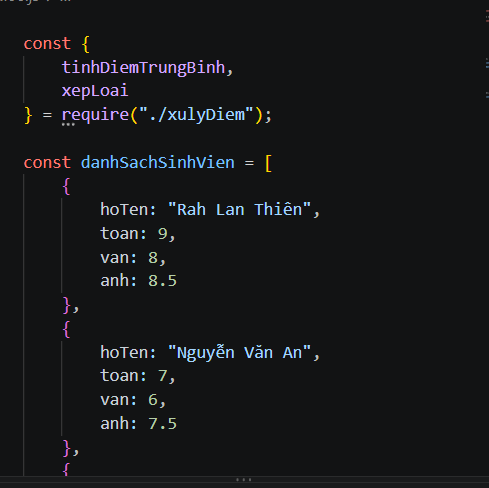
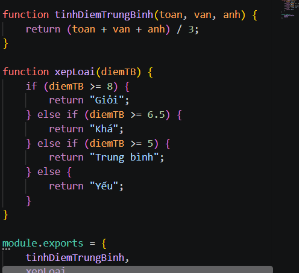
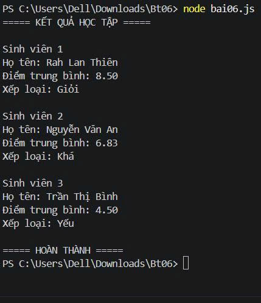

# BÀI 3 - BT06: MODULE TÍNH KẾT QUẢ HỌC TẬP

## 1. Thông tin sinh viên
- Họ tên: Rah Lan Thiên
- Mã sinh viên: CDCNTT18A30
- Lớp: CD-CNT18A

## 2. Mục tiêu bài tập
Xây dựng module tính điểm trung bình của 3 môn
và xếp loại học tập bằng Node.js.

## 3. Các file chương trình
- xulyDiem.js: Chứa hàm tính điểm trung bình
  và hàm xếp loại học tập.
- bai06.js: Sử dụng require() để gọi module
  và tính kết quả của 3 sinh viên.

## 4. Kiến thức sử dụng
- module.exports
- require()
- Hàm JavaScript
- Mảng đối tượng
- forEach()
- console.log()

## 5. Cách chạy chương trình
Mở Terminal trong thư mục Bt06 và nhập:

```bash
node bai06.js
```

## 6. Kết quả chương trình

| Họ tên | Điểm trung bình | Xếp loại |
|---|---|---|
| Rah Lan Thiên | 8.50 | Giỏi |
| Nguyễn Văn An | 6.83 | Khá |
| Trần Thị Bình | 4.50 | Yếu |

## 7. Hình ảnh kết quả Terminal 

### 7.1. Code xulyDiem.js


### 7.2. Code bai06.js


### 7.3. Kết quả chạy Terminal

