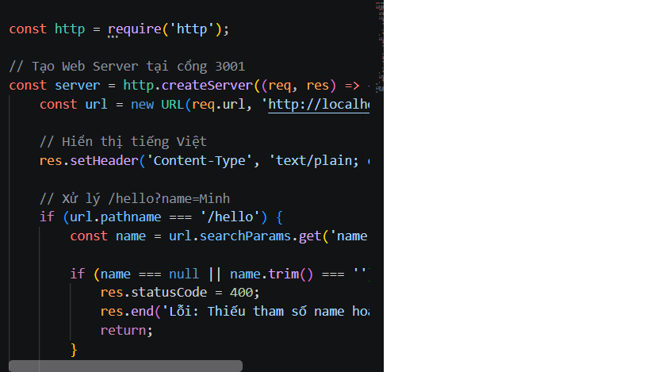
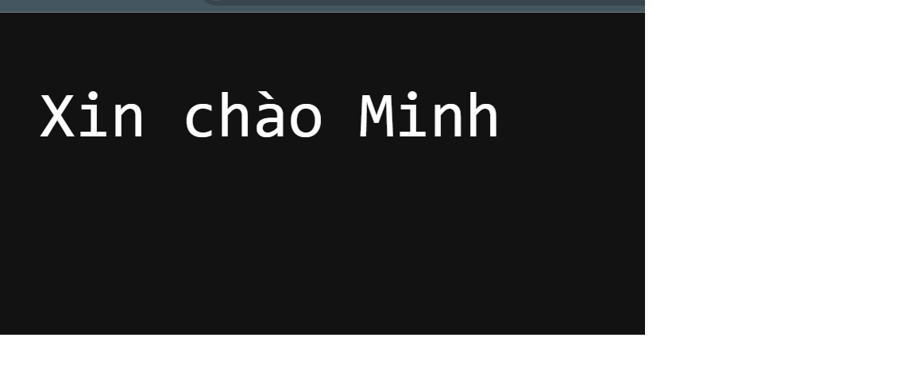
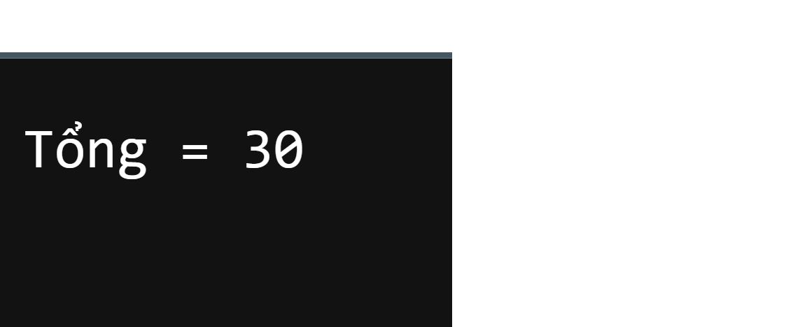
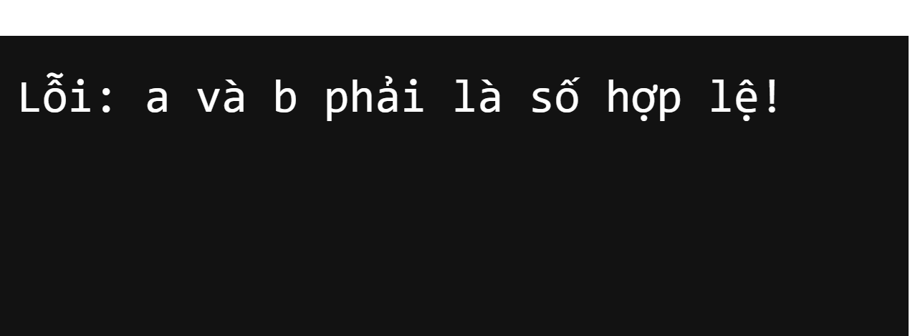

# BÀI 3 - BT07: XỬ LÝ THAM SỐ URL TRÊN WEB SERVER

## 1. Mục tiêu
- Sử dụng module http và đối tượng URL.
- Tạo Web Server chạy tại cổng 3001.
- Xử lý tham số trên URL.
- Kiểm tra và thông báo lỗi khi tham số không hợp lệ.

## 2. Cấu trúc thư mục
- bai07.js: Mã nguồn chương trình.
- Readme.md: Hướng dẫn chạy và kết quả.
- IMEGA: Thư mục lưu ảnh minh chứng.

## 3. Cách chạy
Mở Terminal tại thư mục Bt07 và chạy:

    node bai07.js

Server chạy tại: http://localhost:3001

## 4. Kiểm tra kết quả

### 4.1. Chức năng Xin chào
Đường dẫn: http://localhost:3001/hello?name=Minh

Kết quả: Xin chào Minh

### 4.2. Chức năng tính tổng
Đường dẫn: http://localhost:3001/sum?a=10&b=20

Kết quả: Tổng = 30

### 4.3. Kiểm tra giá trị không hợp lệ
Đường dẫn: http://localhost:3001/sum?a=abc&b=20

Kết quả: Lỗi: a và b phải là số hợp lệ!

### 4.4. Kiểm tra thiếu tham số
Đường dẫn: http://localhost:3001/sum?a=10

Kết quả: Lỗi: Thiếu tham số a hoặc b!

## 5. Hình ảnh minh chứng

### Code chương trình

### Kết quả Xin chào

### Kết quả tính tổng

### Kiểm tra lỗi

    